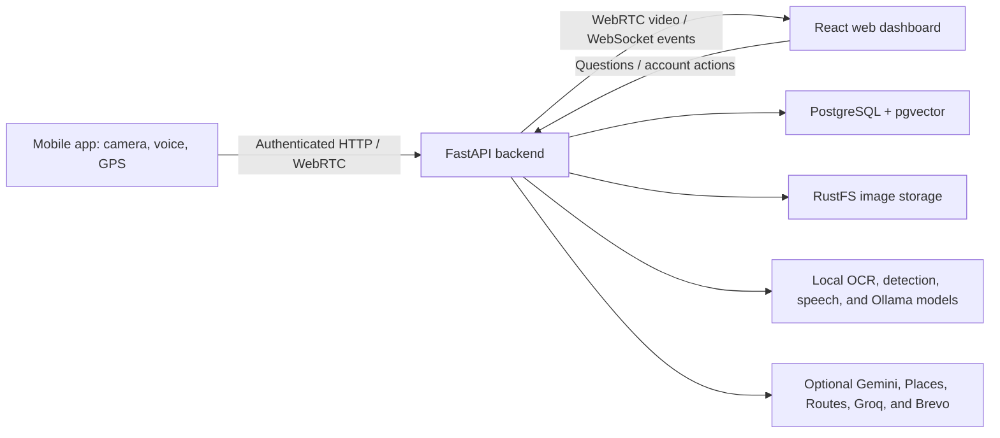

# Sora

**A voice-first visual assistant with searchable camera memory and walking directions.**

Sora connects a mobile camera, an AI backend, and a shared web dashboard to help blind and low-vision users understand their surroundings. It describes visible scenes, reads text, answers spoken questions, remembers selected camera observations, finds nearby places, and provides walking route overviews. Follow-up questions such as **“route to there”** reuse the exact destination returned earlier in the session.

Developed for **Multimedia Database and Image Processing — Fall 2026/2027**.

> Sora is an academic assistive prototype. Camera assessments describe visible evidence and uncertainty; they do not certify walking safety or replace a white cane, guide dog, or trained assistance. Walking directions are route overviews, with no continuous navigation or live rerouting.

## Contents

- [Features](#features)
- [Example interactions](#example-interactions)
- [Architecture and technology](#architecture-and-technology)
- [Getting started](#getting-started)
- [Configuration](#configuration)
- [Operation and updates](#operation-and-updates)
- [Privacy and security](#privacy-and-security)
- [Testing and validation](#testing-and-validation)
- [Limitations](#limitations)
- [Repository and documentation](#repository-and-documentation)

## Features

| Capability | What Sora provides |
| --- | --- |
| Live camera assistance | Native iOS/Android WebRTC publishing, a receive-only dashboard viewer, independent frame sampling, connection refresh, and reconnect handling. |
| Scene understanding | Supported object labels and camera-relative positions, local scene descriptions, and optional Gemini analysis of a current snapshot. |
| Walking assessments | Checks for ground hazards and obstructions directly ahead, including body/head-height obstacles; reports an apparent unobstructed section, a visible blocker, or insufficient evidence. |
| Text reading | Local PaddleOCR for English, French, and Arabic, with image enhancement and spoken playback. |
| Visual memory | Selected images, OCR, objects, captions, timestamps, semantic/lexical search, time filters, and evidence-linked answers. |
| Nearby places | GPS-based Google Places search, named-place filtering, and approximate straight-line distance to the nearest matching result. |
| Walking routes | Google Routes walking distance and ordered instructions with meters per segment. |
| Destination memory | “Route to there,” “take me there,” and similar follow-ups reuse the exact place from the session's previous place answer, using current GPS. |
| Hands-free interaction | Foreground voice questions, explicit app commands, interruptible spoken answers, mute controls, and a microphone waveform. |
| SOS location sharing | An explicit voice or button action submits current GPS and a map link by email to the account's configured SOS contact through Brevo. |
| Shared dashboard | Live video, retained scenes, image details, search, conversations, speech tools, alerts, feedback, and account settings. |
| Accessible interface | Labeled controls, screen-reader states, light/dark appearance, spoken responses, and a scrollable live message panel for long answers. |
| Account and data management | Password authentication, token rotation, device/session revocation, ownership checks, expiry, deletion, and administrator maintenance tools. |

English, French, and Arabic are supported throughout the backend. Speech and recognition quality depend on the language, device, and selected models; English and French are the primary speech demonstration languages.

## Example interactions

### Understanding a scene

| Ask | Expected behavior |
| --- | --- |
| “What is in front of me?” | A quick overview of supported detected objects, with uncertainty about missed objects. |
| “Describe the scene in detail.” | A grounded visual description; uses Gemini for current-view analysis when enabled. |
| “Read the text on this sign.” | Reads legible text from camera evidence. |
| “What did the sign I passed earlier say?” | Searches retained visual memory and cites relevant frame IDs. |
| “Is it safe to walk?” | Assesses the visible ground and forward passage; does not give a blanket safety assurance. |

A clearly visible closed door or wall across the passage counts as a blocker even if the floor is out of view. An unobstructed assessment requires both the ground and the forward passage to be visible. Poor visibility or ambiguous evidence produces an uncertain answer.

### Finding a place and getting there

1. Ask **“What is the nearest restaurant?”** Sora returns the nearest matching place and an approximate straight-line distance.
2. Say **“Route to there”** or **“Take me there.”** Sora requests current GPS and retrieves walking directions to that exact place.
3. Alternatively, ask **“Start a trip to the nearest McDonald's”** to search and retrieve a walking route in one request.

Route answers include the walking distance and the complete ordered provider instructions, with the distance for each segment. The first instruction uses Google's street/compass wording: the app does not know which direction the user is facing. Turns and route distances come from Google Routes rather than being generated by an LLM.

Destination memory stays within the same session and its retained answers. It survives API restarts, expires with the retained data, and is not shared between sessions or accounts. Unrelated camera questions leave the destination intact. A new place search replaces it; an unsuccessful new search clears the reference. Without a remembered destination, Sora asks which place the user means.

### Voice controls

| Say | Action |
| --- | --- |
| “Hey Sora, start stream” | Opens live assistance and starts a consented camera session. |
| “Hey Sora, pause stream” / “resume stream” | Pauses capture or resumes the same session. Use the full “Hey Sora” prefix for each command. |
| “Hey Sora, stop stream” | Ends capture while preserving retained moments until expiry. |
| “Hey Sora, stop listening” / “start listening” | Disables or enables ordinary hands-free questions; explicit app commands remain available. |
| “Hey Sora, mute” / “unmute” | Changes spoken-answer output. |
| “Send my location to my SOS contact” | Submits a location email to the contact saved in Settings. |

Ordinary questions, including route requests, do **not** need the wake phrase. Every utterance beginning with “Hey Sora” is reserved for app controls; unsupported commands receive feedback instead of being sent as questions. Listening runs while the app is open, pauses in the background, and remains available during answer playback so the user can interrupt speech. SOS submission requires location permission and configured email delivery; it does not dispatch emergency services or confirm that the recipient has read the message.

## Architecture and technology



| Layer | Main technologies |
| --- | --- |
| Mobile | Expo SDK 58, React Native, TypeScript, Expo Router, native WebRTC, native speech and speech recognition, Expo Location. |
| Dashboard | React 19, Vite 7, authenticated HTTP/WebSocket clients, receive-only WebRTC video. |
| API and persistence | FastAPI, Pydantic, asynchronous SQLAlchemy, Alembic, PostgreSQL 16, pgvector, RustFS S3-compatible storage. |
| Image processing | OpenCV, Pillow, contrast enhancement, denoising, sharpening, quality checks, and perceptual-hash deduplication. |
| Local AI | YOLO11 nano, PaddleOCR PP-OCRv5, Qwen2.5-VL 3B, Qwen3 Embedding 0.6B, faster-whisper base, and eSpeak NG. |
| Live transport | aiortc, bounded media queues, authenticated signaling, and optional coturn relay. |
| External integrations | Gemini for current images; Google Places and Routes for location queries; Groq for place-query interpretation; Brevo for SOS email. |

### Processing flow

- **Continuous video:** the phone publishes video to the backend, which relays it to dashboard viewers. The default capture target is 720p/60 fps; actual resolution and frame rate adapt to device and network conditions.
- **Live observations:** an independent detector processes the newest available frame with bounded queues and freshness checks. Opt-in alerts describe central detected objects without waiting for OCR or full scene descriptions.
- **Retained memory:** selected frames pass quality/novelty checks, privacy processing, enhancement, OCR, and object detection. Captions and text embeddings can finish asynchronously. PostgreSQL holds metadata and vectors; RustFS holds image variants.
- **Question answering:** quick object overviews use detections; current detailed questions can use Gemini; historical questions retrieve retained evidence for the local model. Visual answers include validated evidence IDs and uncertainty metadata.
- **Places and routes:** the app supplies GPS, Places identifies the destination, and Routes supplies walking instructions. Structured destination memory resolves follow-up references without sending the conversation to an LLM.

Semantic retrieval uses **text embeddings of captions, OCR, and object labels**, rather than image embeddings. Multiple historical images can be combined into a bounded, numbered contact sheet tied to retained evidence IDs.

## Getting started

### Prerequisites

- Docker Desktop with Compose and sufficient disk space for several GB of model weights.
- Node.js **22.12 or newer** and npm.
- Python 3 for the local configuration helper; native backend development requires Python **3.12 or 3.13**.
- An iOS/Android development build containing the project's native WebRTC and speech-recognition modules. **Expo Go cannot run the native streaming workflow.**
- A computer and physical phone that can reach each other on the network. The same Wi-Fi network is the simplest local setup.

Cloud API credentials are optional for the local visual-memory workflow. Gemini, nearby search, walking routes, and SOS email require their corresponding services to be configured.

### 1. Configure and start the backend

Run from the repository root. Replace the example IP with the computer's current LAN IPv4 address:

```sh
python3 backend/scripts/configure_local.py --host 192.168.0.102

docker compose -f backend/docker-compose.yml --profile app --profile webrtc up -d --build

docker compose -f backend/docker-compose.yml exec api python -m scripts.prepare_models

docker compose -f backend/docker-compose.yml restart api
```

The helper generates local credentials, preserves existing secrets, sets the TURN public host, and writes the mobile API origin. Model preparation downloads local detection, OCR, speech, and Ollama weights. The first run can take considerable time; restart the API after preparation finishes. The container applies database migrations automatically.

| Service | Local address |
| --- | --- |
| API health | `http://localhost:8000/health` |
| Interactive API documentation | `http://localhost:8000/docs` |
| Dashboard development server | `http://localhost:5173` |
| RustFS console | `http://localhost:9001` |

The public health endpoint confirms that the API is running. The administrator-only `/ready` endpoint checks dependencies. Use the generated S3 credentials for RustFS. Run exactly **one API worker**: live connections, queues, and event subscriptions are process-local.

For native Python development, local-file image storage, or host-accelerated Ollama, follow the [backend setup guide](backend/README.md).

### 2. Start the dashboard

In a separate terminal:

```sh
cd dashboard
npm ci
npm run dev
```

Open `http://localhost:5173` and register an account. The development server proxies API requests and WebSockets to the local backend. A dashboard environment file is unnecessary for this default setup; use `BACKEND_PROXY_TARGET` for a different development backend.

### 3. Start the mobile app

In another terminal:

```sh
cd mobile
npm ci
npm start -- --dev-client --host lan
```

Connect an installed SDK 58 development app to Metro. If no compatible build is installed, follow the [mobile build instructions](mobile/README.md#installable-apps) first. The native build must contain WebRTC and speech recognition; a JavaScript reload cannot add missing native modules.

Before signing in, use **Change server** to set `http://YOUR_LAN_IP:8000`, then sign in with the dashboard account. A saved server address overrides the environment default. Allow the required local-network, camera, microphone, speech-recognition, and optional location permissions. Complete onboarding, consent to processing, and start live assistance by button or voice. The dashboard follows the account's live session automatically.

### 4. Verify the workflow

Confirm that live video appears on the dashboard, ask “What is in front of me?”, capture/read a sign, and inspect its retained evidence. Then try a nearby search and “route to there” if location services are configured. Test spoken output and scroll through a long route in the mobile message panel.

## Configuration

Private backend credentials belong in **`backend/.env`**. The phone's **`mobile/.env.local`** contains the public API origin. Dashboard variables are described in [`dashboard/.env.example`](dashboard/.env.example). Never put service credentials into `EXPO_PUBLIC_*` or `VITE_*` variables; they are included in client bundles.

### Optional services

| Feature | Backend settings | Required setup |
| --- | --- | --- |
| Gemini current-view analysis | `GEMINI_ENABLED=true`, `GEMINI_API_KEY`, `GEMINI_MODEL` | A Gemini API key with access to the configured model. Default model: `gemini-3.5-flash-lite`. |
| Nearby places | `GOOGLE_PLACE_API_KEY` | Enable Google Places API (New) and permit it on the key. |
| Walking directions | `GOOGLE_ROUTES_API_KEY` or the existing Places key | Enable Google Routes API and permit it on the key. The separate Routes key is optional. |
| Place-query interpretation | `GROQ_API_KEY`, `GROQ_MODEL` | Optional Groq access. Without it, place queries use the built-in fallback interpretation. |
| SOS contact email | `BREVO_API_KEY`, `BREVO_SENDER_EMAIL`, optional `BREVO_SENDER_NAME` | A verified Brevo sender and a recipient saved in the user's Settings. |
| Account verification/recovery email | `SMTP_*`, `AUTH_PUBLIC_URL`, optional `AUTH_REQUIRE_VERIFIED_EMAIL` | Configure SMTP and the public dashboard URL; see the authentication guide. |

Place searches use a **5 km radius** by default. “Nearest” selects the matching result with the smallest straight-line distance; it does not compare walking routes to every branch. Routes always requests walking mode and metric units. Provider failures remain explicit, and a straight-line distance is never substituted for turn instructions.

### Important defaults

| Setting | Default / purpose |
| --- | --- |
| `FRAME_RETENTION_HOURS` | `24`; controls retained session/frame/question lifetime. |
| `SAMPLE_INTERVAL_SECONDS` | `1`; visual-memory sampling interval, independent of video playback. |
| `DETECTION_MAX_AGE_SECONDS` | `2`; local observation freshness and maximum walking-image age before cloud analysis. |
| `GEMINI_WALKING_MAX_AGE_SECONDS` | `6`; maximum total snapshot age after cloud analysis and at final answer validation. |
| `GEMINI_DEADLINE_SECONDS` / `GEMINI_HTTP_TIMEOUT_SECONDS` | `5` / `4`; bounded current-view cloud analysis and HTTP request time. |
| `CURRENT_ANSWER_TIMEOUT_SECONDS` | `8`; local current-view answer-processing budget. |
| `PLACES_TIMEOUT_SECONDS` / `ROUTES_TIMEOUT_SECONDS` | `8` / `8`; provider request limits. |
| `TURN_PUBLIC_HOST` | The computer/server address reachable by the phone. |
| `TURN_PUBLIC_URLS` | Optional explicit public TURN URLs, such as a configured tunnel endpoint. |
| `CORS_ORIGINS` | Exact allowed dashboard/mobile-web origins for authenticated HTTP and WebSocket access. |

Start with [`backend/.env.example`](backend/.env.example). See the [environment and networking reference](backend/docs/environment.md) for database/storage settings, model tuning, ICE/TURN configuration, and Docker/native overrides.

## Operation and updates

### Apply environment changes

A container restart alone does not reload changed environment variables. From the repository root, recreate the API and TURN services after changing backend environment values or networking:

```sh
docker compose -f backend/docker-compose.yml --profile app --profile webrtc up -d --no-deps --force-recreate api turn
```

For a new LAN IP, rerun `configure_local.py --host YOUR_LAN_IP`, recreate the services, and update **Change server** in the phone app. Reconnect active streams after API/TURN restarts.

### Apply code and schema changes

Backend application source is mounted into the local API container. Restart the API after Python changes; rebuild when dependencies or the Docker image change. The Docker startup applies Alembic migrations automatically. An explicit migration can also be run while the API container is available:

```sh
docker compose -f backend/docker-compose.yml exec -T api alembic upgrade head
docker compose -f backend/docker-compose.yml restart api
```

Migration `0006_place_context` adds destination memory. Answers created before this migration contain no destination metadata; ask for the nearby place once after updating. Reload mobile JavaScript for route-follow-up and scrolling changes. Standalone apps with embedded bundles need a new build or a configured update delivery flow; native module changes require a native rebuild.

### Logs and shutdown

```sh
docker compose -f backend/docker-compose.yml logs --tail 100 api
docker compose -f backend/docker-compose.yml --profile app --profile webrtc stop
```

Database, images, and prepared models use named volumes and survive container restarts. Removing those volumes deletes their data. On macOS, running Ollama natively can use host hardware acceleration; the supplied Docker Ollama service is CPU-bound and capped at two cores.

For remote access, configure reachable ICE/TURN addresses and HTTPS/WSS. Phone `localhost` refers to the phone, not the backend computer. Browser microphone/camera APIs require HTTPS or localhost. The Vite development proxy is not a production reverse proxy; use the [dashboard deployment guidance](dashboard/README.md#network-and-production-configuration).

## Privacy and security

- **Consent and ownership:** capture requires consent. Authentication and server-side ownership checks protect sessions, frames, conversations, feedback, and live connections.
- **Authentication:** passwords use Argon2id hashing; access tokens are short-lived and refresh tokens rotate. Native mobile refresh tokens use SecureStore; dashboard refresh tokens use tab-scoped session storage. Access tokens remain in memory.
- **Image privacy:** detected faces are blurred in both retained image variants before storage and analysis. Saved images are normalized and stripped of EXIF metadata. Face detection can miss faces; there is no identity recognition.
- **Retention and deletion:** expired records are hidden from reads. Background cleanup removes metadata and uses a durable deletion outbox for image objects. Users can delete retained data sooner.
- **Transient media:** continuous camera video and uploaded microphone recordings are not retained by the backend. Selected privacy-processed images, session question text, answers, and associated metadata are retained.
- **Cloud data:** enabling Gemini sends a face-redacted snapshot and question to Google. Places/Routes receive the relevant location/query or origin/destination; optional Groq receives the place question for interpretation. SOS sharing sends the requested location email through Brevo. Device speech recognition may also use its platform's network service.
- **Destination memory:** stored place metadata belongs to the session's retained answers, follows their expiry/deletion, and is excluded from the public answer response. Follow-ups request new GPS rather than reusing the earlier origin.

Use consenting scenes for demonstrations. Deployment must use appropriate transport security and credentials; the LAN HTTP setup is intended for local development.

## Testing and validation

Run each component's checks from its directory.

**Backend** — in a Python environment with `requirements-dev.txt` installed:

```sh
cd backend
python -m pytest -q
ruff check app scripts tests migrations
```

**Mobile:**

```sh
cd mobile
npm test
npm run typecheck
npm run lint
```

**Dashboard:**

```sh
cd dashboard
npm test
npm run build
```

The latest targeted validation on **November 11, 2026** passed **176 backend tests**, covering walking/Gemini behavior, Places/Routes, destination memory, evidence freshness, configuration, and authentication, plus all **93 mobile tests** and mobile type/lint checks. Backend Ruff checks passed for the changed Python files. These are automated software checks; they do not establish real-world obstacle recall, route accessibility, speech accuracy, or physical-device usability.

Real-service checks are available after model preparation:

```sh
docker compose -f backend/docker-compose.yml exec api python -m scripts.acceptance --output /tmp/acceptance-report.json
```

The acceptance tool creates its own temporary account and generated signs, exercises video, OCR, retrieval, speech, history, feedback, and deletion, and cleans up its test account/session. It is not a full acceptance test for every optional cloud integration. Use `scripts.smoke`, `scripts.evaluate`, and physical-phone checks for additional validation; see the [testing tools](backend/scripts/README.md), [dated validation history](backend/docs/validation.md), and [demo checklist](docs/demo.md). Historical reports describe the code and configuration at the time of each run.

## Limitations

- A camera frame cannot reveal every drop-off, transparent obstacle, moving hazard, or out-of-view object. A visible-path assessment is about a retained snapshot, not a guarantee about conditions when speech finishes. Traffic/crossing decisions remain uncertain.
- The local 80-class YOLO model does not recognize every relevant obstacle and does not include doors or stairs as dedicated classes. Gemini can interpret these in current-view questions when enabled; this is separate from the immediate local alert path.
- “Unobstructed” requires adequate ground and forward visibility. A visible blocker can still be reported when other areas are unknown. Low-quality or stale evidence and provider failures produce uncertainty or a local fallback.
- Walking routes may omit sidewalks or pedestrian paths. The app provides a spoken overview, not progress tracking, automatic turn announcements, accessible-route certification, or live rerouting.
- Destination memory resolves the most recent place within a session. It is not unrestricted conversational memory and cannot infer which of several unselected places the user means.
- Local vision/language inference can be slow on CPU. Video, live detection, and sampled/deferred visual memory use separate bounded paths, but end-to-end latency still depends on hardware and networking.
- Native permissions, background behavior, screen-reader interaction, microphone sharing, and actual camera-to-speech latency require representative iOS/Android device tests. Background and lock-screen listening are not implemented.

## Repository and documentation

```text
Sora/
├── backend/       FastAPI services, AI pipelines, database migrations, and tools
├── mobile/        Expo/React Native application and mobile tests
├── dashboard/     React/Vite workspace and browser client tests
├── brand/         Shared Sora identity and vector assets
├── docs/          Demo checklist and project presentation
└── README.md      Project overview and setup
```

| Guide | Contents |
| --- | --- |
| [Backend](backend/README.md) | Native/Docker setup, processing, models, Gemini, Routes, and destination memory. |
| [Mobile](mobile/README.md) | Development/standalone builds, permissions, voice controls, streaming, and account workflows. |
| [Dashboard](dashboard/README.md) | Shared sessions, video, conversations, account/admin tools, and deployment. |
| [API reference](backend/docs/api.md) | Authenticated endpoints, media protocols, and events; also see the running `/docs` explorer. |
| [Environment and networking](backend/docs/environment.md) | Configuration precedence, storage/models, WebRTC, TURN, and deployment settings. |
| [Authentication](backend/docs/authentication.md) | Registration, ownership, tokens, recovery, SMTP, and administrator setup. |
| [Requirements mapping](backend/docs/requirements.md) | Academic requirements and their backend implementation. |
| [Validation history](backend/docs/validation.md) | Dated checks, real-service measurements, and known limits. |
| [Evaluation and utility scripts](backend/scripts/README.md) | Model preparation, test media processing, benchmarking, cleanup, and evaluation. |
| [Demo checklist](docs/demo.md) | Demonstration preparation and physical-device checks. |
| [Presentation](docs/presentation.html) | HTML presentation; open locally in a browser. |
| [Brand assets](brand/README.md) | Shared icons, artwork, colors, and asset generation. |
